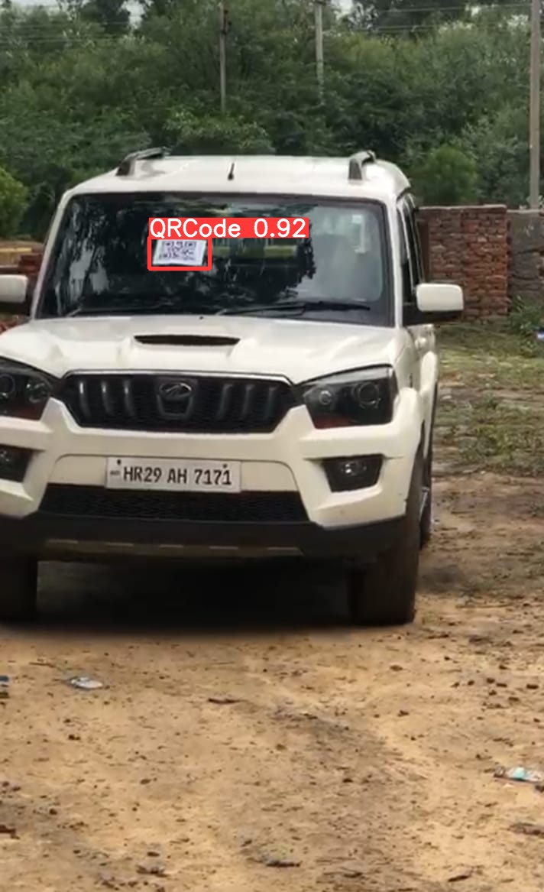

# YOLOv8 Object Detection

A computer vision project exploring object detection using **Ultralytics YOLOv8** and Python. The repository includes a Jupyter Notebook for model training, a YOLOv8 nano model weights file, and a result image.

<p align="center">
  
</p>

## Project Overview

Object detection is a computer vision task that identifies objects in an image and locates them with bounding boxes. This project uses the YOLOv8 workflow to train or experiment with an object detection model and inspect the resulting predictions.

**Repository:** [Object_Detection_YoloV8](https://github.com/khatana706/Object_Detection_YoloV8)

## Key Files

| File | Description |
|---|---|
| `Model_Training_YoloV8.ipynb` | Jupyter Notebook containing the model-training workflow. Review the notebook cells for dataset configuration and execution steps. |
| `yolov8n.pt` | YOLOv8 nano model weights file included in the repository. |
| `Result.jpg` | Image showing an example result from the project. |

## Tech Stack

- Python
- Ultralytics YOLOv8
- PyTorch
- Jupyter Notebook
- Computer Vision / Deep Learning

## Getting Started

### 1. Clone the repository

```bash
git clone https://github.com/khatana706/Object_Detection_YoloV8.git
cd Object_Detection_YoloV8
```

### 2. Create and activate a virtual environment (recommended)

**Windows**

```bash
python -m venv .venv
.venv\Scripts\activate
```

**macOS / Linux**

```bash
python3 -m venv .venv
source .venv/bin/activate
```

### 3. Install the dependencies

```bash
python -m pip install --upgrade pip
pip install ultralytics jupyter
```

If the notebook imports additional libraries, install those dependencies as well. For GPU acceleration, install a PyTorch build compatible with your system and CUDA setup.

### 4. Open the notebook

```bash
jupyter notebook Model_Training_YoloV8.ipynb
```

Run the notebook cells in order. Before training, verify that the dataset paths, annotation format, and data configuration referenced in the notebook are available in your environment.

## Quick Prediction Example

The following example runs inference with the included YOLOv8 nano weights on an image. Replace `path/to/image.jpg` with the path to your own image.

```python
from ultralytics import YOLO

# Load the included YOLOv8 nano weights
model = YOLO("yolov8n.pt")

# Run object detection on an image
results = model.predict(
    source="path/to/image.jpg",
    conf=0.25,
    save=True
)

# Print detected class names and confidence scores
for result in results:
    for box in result.boxes:
        class_id = int(box.cls[0])
        confidence = float(box.conf[0])
        class_name = result.names[class_id]
        print(f"{class_name}: {confidence:.2f}")
```

By default, prediction outputs are saved by Ultralytics in a run directory such as `runs/detect/predict/`. The exact directory name may change between runs.

## Training

The repository includes `Model_Training_YoloV8.ipynb` for the training workflow. Open the notebook and check its dataset configuration before running it.

For a custom dataset, the Ultralytics YOLO format typically requires:
- Images split into training and validation sets.
- Corresponding YOLO-format label files.
- A dataset YAML file specifying the paths and class names.

A generic training example is shown below. Update `data.yaml` to match your actual dataset configuration before running it.

```python
from ultralytics import YOLO

model = YOLO("yolov8n.pt")
model.train(
    data="path/to/data.yaml",
    epochs=50,
    imgsz=640
)
```

This is a generic example, not a claim about the exact settings used in the included notebook.

## Results

See [`Result.jpg`](Result.jpg) for the result image included in this repository. For reproducible evaluation, record the dataset details and report metrics such as precision, recall, and mAP from the validation run. No quantitative accuracy figures are claimed here.

## AUTHOR
Name :- NARENDRA SINGH

## References

- [Ultralytics YOLOv8 repository](https://github.com/ultralytics/yolov8)
- [Ultralytics documentation](https://docs.ultralytics.com/)

